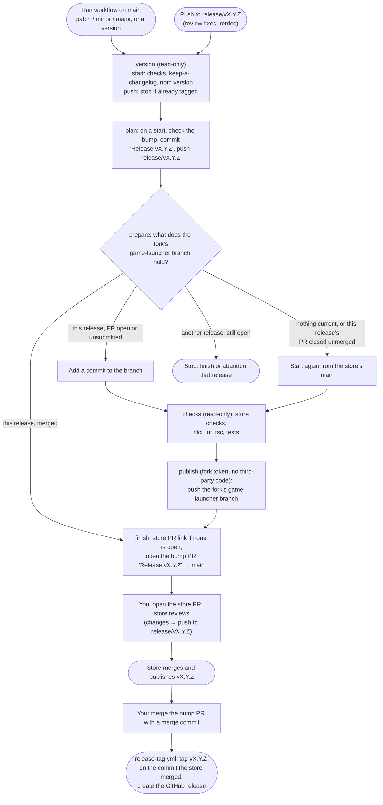

# Development

Toolchain: Node 22 (ideally the same one Vicinae uses) and pnpm. There are no native dependencies; the VDF parsers,
the `.ico` extractor and the PNG encoder are all plain TypeScript.

```bash
pnpm install
pnpm dev          # live-reloading dev session inside the running Vicinae
pnpm test         # unit tests (synthetic Steam/Lutris/Heroic fixtures, no real installs needed)
pnpm typecheck
pnpm lint         # validates the extension manifest
pnpm build        # builds and installs into ~/.local/share/vicinae/extensions

LOCAL_STEAM=1 pnpm test local-steam                     # smoke test against this machine's Steam install
BENCH=1 pnpm exec vitest run scan-bench --silent=false  # scan timing on synthetic 500/2000-game libraries
```

When editing several files at once, stop `pnpm dev` first: it rebuilds on every save, and a half-finished change
can load into Vicinae.

## Project layout

```
src/search-games.tsx            the command: scanning, merging, filters, hidden state, dropdown
src/components/                 game grid and list, action panels, Launcher Priority view
src/hooks/use-hires-artwork.ts  fills the artwork cache in the background; re-renders as art arrives
src/lib/games.ts                launcher-independent Game model, launcher names and default order
src/lib/library.ts              scanLaunchers (disk) + combineLibrary (merge by priority, in memory), empty states
src/lib/steam/                  Steam integration: install detection, manifests, appinfo.vdf, collections, artwork
src/lib/lutris/                 Lutris integration: install detection, read-only SQLite, categories, artwork
src/lib/heroic/                 Heroic integration: install detection, per-store JSON lists, favourites, artwork
src/lib/vdf/                    text and binary KeyValues (VDF) parsers
src/lib/image/                  .ico extraction and a minimal PNG encoder
src/lib/artwork-cache.ts        high-resolution artwork cache (Steam CDN, Heroic art URLs): download, refresh, prune, clear
src/lib/artwork-requests.ts     which artwork the current layout needs
src/lib/visibility.ts           hiding rules: ours and the launcher's, with "shown here" overrides
src/lib/game-views.ts           dropdown views: installed, per launcher, hidden, collections
src/lib/launcher-priority.ts    launcher order: normalize, load, save, move
test/                           vitest suites and fixtures (fake Steam/Lutris/Heroic installs, appinfo/.ico writers)
assets/, assets-src/            extension icon (PNG), its SVG source, and alternate colour schemes
docs/screenshots/               README screenshots (WebP)
CHANGELOG.md                    release notes (Keep a Changelog); new entries go under [Unreleased]
scripts/sync-to-store.sh        copies a release into a vicinae-extensions checkout (see Releasing)
scripts/changelog-notes.sh      prints one release's CHANGELOG.md section
scripts/store-state.sh          reports the store side of a release (fork branch, store pull requests) for the workflows
.github/workflows/              store-release.yml (releases to the store), release-tag.yml (tags merged releases)
```

## Adding a launcher

Each launcher is a module that returns a `LauncherScan` (see `src/lib/games.ts`): its games, collections, hidden
list, where it looked, and any warnings or settings problems. To add one:

1. Add it to `GameSource`, `LAUNCHER_NAMES` and `LAUNCHER_PRECEDENCE` in `games.ts`.
2. Write `src/lib/<launcher>/scan.ts`. Detect a single install (folder setting first), give games ids of the form
   `<launcher>:<stable id>`, set a `launchUri`, and fill in `storeIds` (e.g. `gog:<id>`) so duplicates merge.
3. Call it from `scanLaunchers` in `library.ts`, and add a not-found hint for the empty state.
4. Add an on/off checkbox and a folder setting to `package.json`, and read them in `search-games.tsx`.

The extension icon (deep sea) is rendered from `assets-src/extension_icon.svg` with:

```bash
magick -background none -density 192 assets-src/extension_icon.svg -resize 512x512 -depth 8 assets/extension_icon.png
```

Alternate colour schemes (charcoal and amber, midnight teal, plum) are kept in `assets-src/alternates/`. To switch, copy one
over `assets-src/extension_icon.svg` and re-render. Only `assets/` ships with the extension.

## Releasing to the Vicinae store

The store ([vicinaehq/extensions](https://github.com/vicinaehq/extensions)) keeps its own copy of each extension under
`extensions/<name>` and publishes it when a pull request is merged. This repo stays the source of truth; releases reach
the store through the fork [DavidSeptimus/vicinae-extensions](https://github.com/DavidSeptimus/vicinae-extensions) on a
`game-launcher` branch. Releases are started by hand, one at a time.

### Changelog

`CHANGELOG.md` follows [Keep a Changelog](https://keepachangelog.com/en/1.1.0/). Add entries under `## [Unreleased]` as
you make changes, grouped as `### Added`, `### Changed`, `### Deprecated`, `### Removed`, `### Fixed` or
`### Security`. Starting a release turns that section into `## [X.Y.Z] - date`, adds a new empty `[Unreleased]`, and
updates the links at the bottom, using [keep-a-changelog](https://github.com/oscarotero/keep-a-changelog). A release
with no entries under `[Unreleased]` (headings alone don't count) is refused.

### Cutting a release

1. **Start it.** Actions › Store release › **Run workflow** on `main`. Pick the bump (patch, minor or major), or type an
   exact version (the first release is `1.0.0`; pre-release versions are refused). The workflow sets
   `package.json`'s version, dates the changelog, commits that as "Release vX.Y.Z" on a new `release/vX.Y.Z` branch,
   and sends that commit to the store fork.
2. **Open the store pull request** from the link in the run's summary.
3. **Answer the store review.** Commit any changes the reviewers ask for to `release/vX.Y.Z` and push; each push is sent
   to the store pull request. Amending or force-pushing the branch is fine. If a store maintainer pushes to the pull
   request themselves, copy their change into `release/vX.Y.Z` too: a push that would undo it is refused.
4. **Merge the bump pull request** ("Release vX.Y.Z", opened by the workflow once the store has the release) after the
   store has merged it, **with a merge commit** (not squash or rebase, so the tag stays in `main`'s history). Merging
   tags `vX.Y.Z` on the commit the store merged and creates the GitHub release with the changelog section as its
   notes. If the store hasn't merged yet, tagging fails; re-run it (Actions › Tag release › Re-run all jobs) once it
   has.

Pushes to `release/vX.Y.Z` keep being sent until the store merges the release, so they also cover retries: if a run
fails (say, a store check), fix it on the release branch and push; if the store closes its pull request without
merging, push again (an empty commit will do) to send the release afresh. After the store merges, pushes to the
branch aren't sent (even if the fork's branch has been deleted), and once the release is tagged they do nothing at all.

If the bump pull request was merged before the store merged, the tag job fails, but nothing is stuck: review changes
pushed to `release/vX.Y.Z` are still sent, and once the store merges, re-run the failed Tag release run.

A new release can't start while a bump pull request is open, a store pull request is open, or the fork's
`game-launcher` branch holds a release that never became a store pull request.

**Abandoning a release:** close the store pull request (if any), delete the fork's `game-launcher` branch
(<https://github.com/DavidSeptimus/vicinae-extensions/branches>), close the bump pull request (if any) and delete the
`release/vX.Y.Z` branch here.

While the store is reviewing a release, don't use GitHub's "Update branch" or "Resolve conflicts" on the bump pull
request: that merges `main` into the release branch, and the next push would send `main`'s newer work to the store.
After the store merges, resolving conflicts (typically in `CHANGELOG.md`, from entries added to `[Unreleased]` on
`main` meanwhile) is safe: those pushes aren't sent, and the tag still goes on the commit the store merged.

Pushes to different release branches, and starting a release, run independently. Pushes to the same branch run one at
a time; if several queue up, GitHub keeps only the newest waiting run, which sends the newest commits anyway.

### What goes to the store

`scripts/sync-to-store.sh` builds the store copy from the release commit:

- **README**: only the parts between `<!-- description -->` and `<!-- end-description -->` markers, joined in order.
  Sections for this repo only, such as installing from source and Development, stay outside the markers. The sync
  fails if the markers are missing, nested or unclosed.
- **Left out**: the pnpm files, `vicinae-env.d.ts` (generated), `docs/development.md`, `assets-src/`, and the release
  tooling (`.github/`, `scripts/`).
- **Changed**: the store builds with npm, so the copy gets a `package-lock.json` and no `packageManager` field. The
  lockfile already in the store is kept and only updated where `package.json` changed, so dependency versions don't
  drift between releases.

### How the workflows run

`.github/workflows/store-release.yml` runs on **Run workflow** (start a release) and on pushes to `release/v*`. Its jobs
are split so that no token with write access is present while third-party code (keep-a-changelog, dependency installs,
the build, the tests) runs, and that code can't change what gets pushed. Every store commit it makes ends with a
`Source-Commit: <sha>` trailer naming the release-branch commit it came from. `scripts/store-state.sh` reads them
back: a commit belongs to the release whose "Release vX.Y.Z" commit is the newest one in its history, which tells
which release the fork's branch holds and whether a merged store pull request contained this release.

- **version** (read-only) on a start: checks nothing else is in flight, runs keep-a-changelog and `npm version`, checks
  the version is a plain X.Y.Z higher than the last, and hands the two edited files on. On a push: stops the run if the
  release is already tagged.
- **plan** (writes to this repo, no third-party code) checks the edit is only the bump (`package.json` differs only in
  `version`, `CHANGELOG.md` only in release headings and links), commits "Release vX.Y.Z" and pushes
  `release/vX.Y.Z`. On a push, it just passes that commit on.
- **prepare** (no third-party code) decides where the release goes on the fork:
  - the store has merged this release: nothing to send;
  - the fork's branch holds this release with a store pull request open, or not yet submitted: add a commit to it;
  - anything else (no branch, an earlier merged release, or this release's pull request closed without merging): start
    again from the store's `main`;
  - the fork's branch holds a *different* release that is still open or unsubmitted: stop with instructions.

  It then syncs the extension and refuses the sync if it would undo a change from a commit on the fork's branch that
  it didn't make (the change must still reverse-apply to the synced tree). It uploads the change as a patch with its
  commit message, and records their hash. Nothing is sent if the store branch already has this content.
- **checks** (read-only) applies the patch and runs the store's pull-request checks the way the store does
  (`validate-extension.ts` on the clean tree, then `npm ci --legacy-peer-deps` and `bunx vici build` on the runner's
  default Node), then our own `vici lint`, `tsc --noEmit` and tests on Node 22.
- **publish** (holds the fork token, no third-party code) checks the patch against the hash from **prepare** and
  refuses one that touches anything outside `extensions/game-launcher`, syncs the fork's `main` when the branch starts
  from it, commits, and pushes. The push fails if the
  branch moved since **prepare** looked at it.
- **finish** runs once the store has the release (just sent, already on the fork's branch, or already merged). It links
  to a new store pull request when none is open (title and, if short enough, description prefilled; full description
  shown), and opens the "Release vX.Y.Z" bump pull request into `main` unless one is open or merged already.

`.github/workflows/release-tag.yml` runs when a `release/v*` pull request is merged into `main`. It finds the last
commit a merged store pull request took from that release branch (from the `Source-Commit` trailers), checks its
`package.json` version, tags it and creates the GitHub release. It fails if the store hasn't merged the release. It
warns if the store's pull request also merged commits that aren't on the release branch (bring those into `main`), and
if the bump pull request wasn't merged with a merge commit.



### One-time setup

- **Fork token.** A fine-grained personal access token stored as the `STORE_FORK_TOKEN` Actions secret on this repo.
  Repository access: only `DavidSeptimus/vicinae-extensions`. Permissions: Contents read and write, and Workflows read
  and write (needed when syncing the fork's `main` brings in changes to the store's own workflows).
- **Pull requests from Actions.** In this repo's Settings › Actions › General › Workflow permissions, tick "Allow
  GitHub Actions to create and approve pull requests", so the workflow can open the bump pull request.

### Trying a release locally

`scripts/sync-to-store.sh` takes a vicinae-extensions checkout and a git ref (default `HEAD`; uncommitted changes
aren't copied), and needs npm for the lockfile. It only touches `extensions/game-launcher` and commits nothing. This
reproduces a release that starts from the store's `main` (the first submission, or the first release after a merge);
with a store pull request open, the workflow builds on that branch and its lockfile instead.

```bash
git -C ../vicinae-extensions fetch upstream
git -C ../vicinae-extensions switch -c try-release upstream/main
scripts/sync-to-store.sh ../vicinae-extensions
cd ../vicinae-extensions/extensions/game-launcher
npm ci --legacy-peer-deps && npx vici build --out /tmp/game-launcher-build && npx tsc --noEmit && npm test
```

To preview a version bump without committing it, run the same command the workflow uses with `--dry-run`:

```bash
npx keep-a-changelog@3.2.0 --format=markdownlint --release --version=minor --create=none --dry-run
```

`scripts/changelog-notes.sh CHANGELOG.md Unreleased` prints what the next release will contain, and this shows what
the workflows will see on the store side (open and merged store pull requests, the fork branch and its release):

```bash
FORK=DavidSeptimus/vicinae-extensions UPSTREAM=vicinaehq/extensions BRANCH=game-launcher \
  scripts/store-state.sh . v1.2.0
```

To clean up afterwards:

```bash
rm -rf ../vicinae-extensions/extensions/game-launcher
git -C ../vicinae-extensions switch main && git -C ../vicinae-extensions branch -D try-release
```
